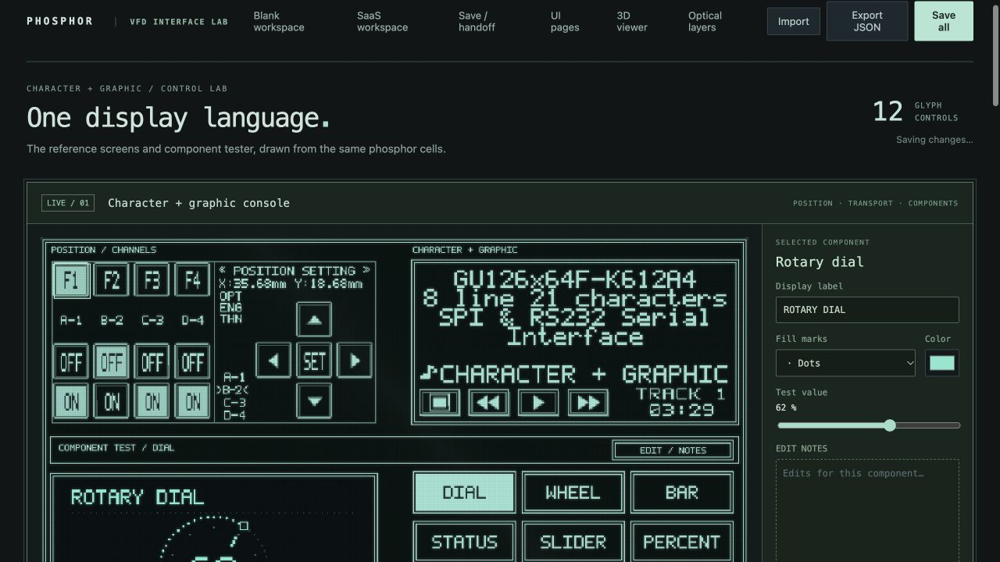
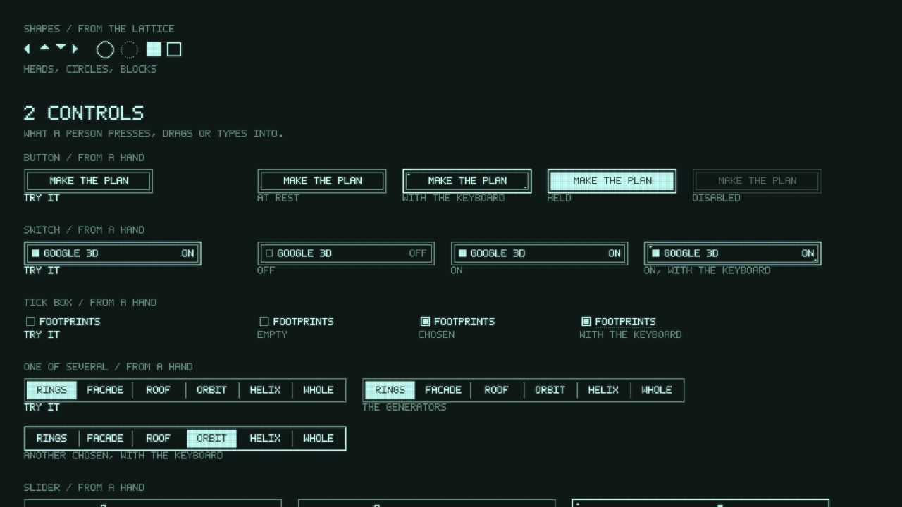

# Phosphor UI

A reusable VFD visual system: bitmap glyphs, one shared display grid, tunable optical shaders, interactive controls, complete example screens, a 26-page flow editor, and a Three.js hologram/point-cloud viewer.

This is native browser JavaScript and CSS. No frontend framework, build step, package installation, or cloud account is required. Node.js 22+ runs the local server and tests; a browser with WebGL 2 enables the optical effects. Native controls provide accessible hit targets and keyboard interaction.



## Run

```sh
git clone https://github.com/quis80jab/phosphor-ui.git
cd phosphor-ui
npm start
```

Open **http://127.0.0.1:5190/workbench.html**. Alternatively, serve `dist/` with any static HTTP server:

```sh
python3 -m http.server 5190 --bind 127.0.0.1 --directory dist
```

## Visual elements and screens

| Page under `http://127.0.0.1:5190/` | Included |
| --- | --- |
| `sandbox-ui/elements.html` | 60 interactive visual elements across six layers, from primitives to panels, with input adapters |
| `workbench.html` | Dials, wheels, bars, indicators, sliders, percentages, search, buttons, toggles, steppers, meters, segmented controls; editable notes and settings |
| `index.html` | Optical-layer editor, position-setting screen, transport display, cursor hotspot, lens effects, color/contrast/glow tuning and PNG bake |
| `ui-pages.html` | Component catalog, welcome, cases, spare parts, value charts, logistics map and alerts |
| `saas.html` | Dashboard, charts, graphs, meters, data tables and SaaS workspace examples |
| `blank.html` | Grid layout editor, seven grouped navigation tabs, linked pages, rectangles, dividers, labels, preview, import/export and undo |
| `viewer.html` | 3D turntable, splats, voxels, point selection/lasso/groups, histogram, playback, scrubber and overlays |
| `viewer.html?mode=hologram` | Online OSM map, projector cone, voxel outlines, edge emission, source-path falloff, compass, drone telemetry and virtual joysticks |
| `integration-example.html` | Small host program using the exported component kit |
| `handoff.html` | Component contracts and portable settings backup/restore |

For the full **26-page, 261-element** example, open the layout editor and import
[`handoff/designer/arachnid.flow-design.json`](handoff/designer/arachnid.flow-design.json).
The historical fixture filename is retained for compatibility. The public preview
uses synthetic topology and records. Main groups are Home, Site, Cases, Assets,
System, Calendar and Analyze; the rail exposes linked pages with independent
expand/collapse controls and **Expand All**.



## Use in another program

Copy `dist/` into your static assets and preserve relative paths. A small component kit is exported by `dist/phosphor-kit.js`:

```js
import {mountPhosphorKit} from './phosphor-kit.js';

const ui = mountPhosphorKit({
  container: document.querySelector('#controls'),
  columns: 48,
  pattern: 'dots',
  optics: {brightness: 110, glow: 40, contrast: 110, grid: 50, refraction: 0},
  controls: [
    {id: 'enabled', type: 'toggle', label: 'OUTPUT', value: true,
     layout: {column: 0, row: 0, columns: 16, rows: 3}},
    {id: 'gain', type: 'slider', label: 'GAIN', value: 62, min: 0, max: 100, step: 1,
     layout: {column: 0, row: 4, columns: 48, rows: 3}}
  ],
  onChange({id, value}) { console.log(id, value); }
});

ui.update('gain', {value: 80});
// ui.destroy() when the host unmounts.
```

The kit mounts buttons, toggles, sliders, search and labels. The broader workbench,
page painters, charts, drone cluster, topology and viewers have their own APIs;
see the [integration guide](handoff/HANDOFF.md), [component contracts](handoff/COMPONENTS.md)
and [machine-readable inventory](handoff/component-manifest.json).

## Rendering contract

- One static display lattice: `PIXEL_PITCH = 2 / 1.4` CSS pixels.
- One UI layout grid: each cell is **8 × 8 display pixels**.
- Repaint controls at their destination dimensions. Do not stretch existing raster artwork.
- Keep 5 × 7 glyphs and thin rules on integer display cells.
- Composite the 3D scene and raster UI through the shared VFD shader.

Start with `viewer-grid.js`, `viewer-grid-paint.js`, `viewer-grid-renderer.js`,
`vfd-glyphs.js`, `vfd-renderer.js` and `phosphor-kit.js`.

## Data and licenses

The public repo includes a credited **Pumpkin!** Gaussian sample (CC BY 4.0).
Other capture payloads are optional and explicitly disabled until installed;
[asset instructions](docs/OPTIONAL-ASSETS.md) explain how to enable them.
Private recordings, saved browser notes/settings, hosting credentials and
internal implementation-status data are excluded. The local working app is
separate from this public snapshot.

OSM map loading uses online Overpass endpoints. Other visual examples run locally.
Drone controls, authentication screens, telemetry, thermal feeds, cases and topology
are UI simulations, not connected hardware or backend services. Settings and notes
save to browser-local storage; use export/import to move them.

Original UI code is licensed under the **[MIT License](LICENSE)**, allowing reuse,
modification and redistribution, including commercial use. Dependencies, OSM and
the sample capture retain their separate [third-party licenses](THIRD_PARTY_NOTICES.md).

## Validate

```sh
npm test
npm run check:layout
```

Tests include pure render/state contracts, import/export, grid alignment,
component interactions, voxel/path calculations and synthetic recording fixtures.
Optional scan-payload validation is explicitly skipped when those external files
are absent. Open the pages in a WebGL 2 browser to inspect GPU rendering.
